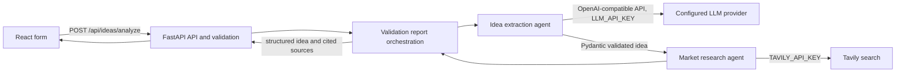

# AI Startup Idea Validator

A React/Vite submission workspace backed by FastAPI. The analysis endpoint uses a configurable OpenAI-compatible chat completions API to extract a validated startup concept, then Tavily to retrieve market, competitor, and trend sources. The existing manual submission endpoint remains available.

## Architecture



## Setup

### Backend

Python 3.10+ is recommended. From `backend/` create and activate a virtual environment, then install dependencies:

```powershell
cd backend
python -m venv .venv
.venv\Scripts\Activate.ps1
pip install -r requirements.txt
Copy-Item .env.example .env
uvicorn main:app --reload --port 8000
```

Set `LLM_API_KEY` and `TAVILY_API_KEY` in `backend/.env` before calling the analysis endpoint. `LLM_MODEL` defaults to `gpt-4o-mini`; `LLM_BASE_URL` defaults to `https://api.openai.com/v1` and can point to a compatible provider. `FRONTEND_ORIGIN` is a comma-separated allowlist. The analysis endpoint reports missing credentials explicitly and never returns fabricated results.

### Frontend

From the repository root:

```powershell
npm install
# Optional: set VITE_API_BASE_URL in a root .env.local; defaults to http://localhost:8000
npm run dev
```

Vite serves on port 5173 by default.

## Endpoints

- `GET /` ? health message.
- `POST /api/ideas` ? validates and echoes the submitted form fields (backward-compatible).
- `POST /api/ideas/analyze` ? extracts a structured idea, searches Tavily, and returns `{ idea, market_research }`. Validation failures use HTTP 422; missing configuration returns HTTP 503; provider/network errors include a clear HTTP error.
- `/docs` ? interactive Swagger UI.

The LLM response schema contains `problem`, `proposed_solution`, `target_customers`, `industry`, `key_features`, `value_proposition`, and `assumptions_and_missing_information`. Research includes separate market information, competitor/alternative, and trend groups with source titles, URLs, and snippets.

## Tests and build

```powershell
cd backend
pytest
cd ..
npm run build
```

Automated backend tests mock provider calls and cover request validation, missing keys, malformed LLM JSON, and education, healthcare, and agriculture inputs. Live provider behavior requires valid credentials and is not covered by mocked tests.

## Known limitations

The LLM integration uses OpenAI-compatible chat completions and expects JSON mode. Tavily is queried once for each of three research categories. The service returns raw research sources, not a scored market viability conclusion. The legacy `backend/venv/main.py` is retained for compatibility; the maintained application entry point is `backend/main.py`.
