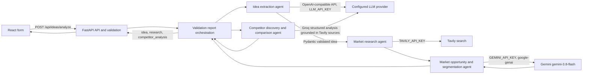

# AI Startup Idea Validator

A React/Vite submission workspace backed by FastAPI. The analysis workflow extracts a validated startup concept with the configured OpenAI-compatible provider, searches Tavily, and runs market opportunity analysis with the team's Google Gen AI SDK and Gemini model. Competitor and SWOT/risk analysis continue using the configured OpenAI-compatible provider. The existing manual submission endpoint remains available.

## Architecture



## Setup

### Backend

Python 3.10+ is recommended. From `backend/` create and activate a virtual environment, then install dependencies:

```powershell
cd backend
python -m venv venv
venv\Scripts\Activate.ps1
pip install -r requirements.txt
Copy-Item .env.example .env
uvicorn main:app --reload --port 8001
```

Set `LLM_API_KEY`, `GEMINI_API_KEY`, and `TAVILY_API_KEY` in `backend/.env` before calling the analysis endpoint. The market opportunity/customer segmentation agent uses `gemini-3.8-flash` through the official `google-genai` SDK. Idea extraction, competitor analysis, and SWOT/risk use the OpenAI-compatible provider: `LLM_MODEL` defaults to `openai/gpt-oss-20b`, and `LLM_BASE_URL` defaults to `https://api.groq.com/openai/v1`. `FRONTEND_ORIGIN` is a comma-separated allowlist. The analysis endpoint reports missing credentials explicitly and rejects invalid structured output.

### Frontend

From the repository root:

```powershell
npm install
# Optional: set VITE_API_BASE_URL in a root .env.local; defaults to http://localhost:8001
npm run dev
```

Vite serves on port 5173 by default.

## Endpoints

- `GET /` ? health message.
- `POST /api/ideas` ? validates and echoes the submitted form fields (backward-compatible).
- `POST /api/ideas/analyze` ? extracts a structured idea, searches Tavily, and returns `{ idea, submitted_budget, market_research, competitor_analysis, research_note }`. Validation failures use HTTP 422; missing configuration returns HTTP 503; provider/network errors include a clear HTTP error.
- `/docs` ? interactive Swagger UI.

The LLM response schema contains `problem`, `proposed_solution`, `target_customers`, `industry`, `key_features`, `value_proposition`, and `assumptions_and_missing_information`. Research includes separate market information, competitor/alternative, and trend groups with source titles, URLs, and snippets.

The competitor agent reuses the `competitors_and_alternatives` Tavily sources and returns typed competitor comparisons: offering, target customers, pricing (`"Unknown"` when unavailable), strengths, limitations, and evidence URLs. Potential gaps have a rationale and a strict `gap_type` of `evidence_based` or `hypothesis`. When no competitor search sources are available, it returns empty arrays without another LLM request. The React results section shows these fields and source links while retaining the existing response JSON.

## Tests and build

```powershell
cd backend
.\venv\Scripts\python.exe -m pytest -q
cd ..
npm run lint
npm run build
```

Automated backend tests mock provider calls and cover competitor discovery, unknown pricing, evidence URL validation, malformed output, provider errors, timeouts, orchestration order, budget preservation, and API compatibility. Live provider behavior requires valid credentials and is not covered by mocked tests.

## Known limitations

Tavily is queried once for each of three research categories; competitor analysis reuses those result records. The competitor agent makes one extra LLM request only when competitor sources exist. Citations are validated against the supplied Tavily URLs, but the application does not independently verify that each snippet semantically entails every generated claim. Users should inspect linked sources before relying on a claim. Competitor coverage depends on search results and does not prove that all competitors or market gaps have been found. The legacy `backend/venv/main.py` is retained for compatibility; the maintained application entry point is `backend/main.py`.
