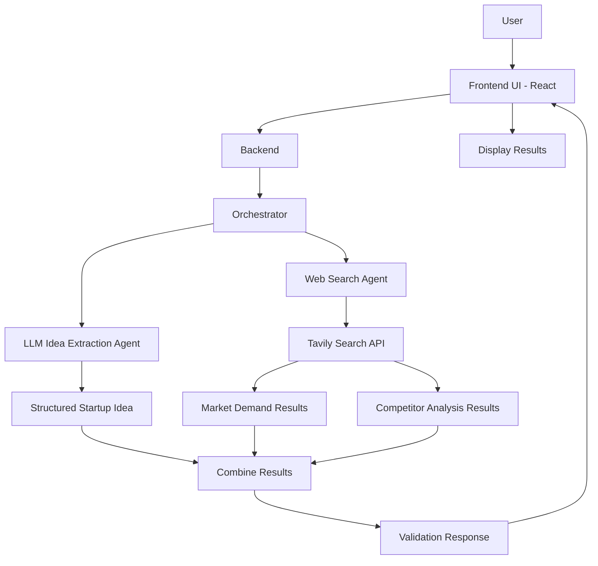

# AI-Based Startup Idea Validator
## System Architecture

## Component Responsibilities

- **Frontend UI:** Collects startup idea details and displays results.
- **Backend:** Receives requests from the frontend.
- **Orchestrator:** Coordinates the extraction and web search functions.
- **LLM Idea Extraction Agent:** Converts the raw idea into structured information.
- **Web Search Agent:** Uses Tavily to retrieve market and competitor information.
- **Result Combination:** Combines the structured idea and search results.
- **Validation Response:** Returns the combined information to the frontend.

## Initial Workflow

1. The user submits a startup idea through the frontend.
2. The backend passes the idea to the orchestrator.
3. The orchestrator calls the LLM extraction function.
4. The orchestrator calls the Web Search Agent.
5. Both outputs are combined into a single response.
6. The frontend displays the results.

Note: The diagram represents the planned initial workflow.
Actual integration and testing will confirm the final implementation.
